# The development flow

How work moves in this pack: an idea or a bug becomes an issue, the issue becomes a contract, the contract becomes
a card, the card becomes a reviewed PR, and a milestone is accepted on behaviour rather than on diff-reading. The
figures below are exports of the pack's own map — every box is a real skill, script or piece of board state.

**Legend.** The same kinds appear in every figure:

| Shape | Kind | Means |
|---|---|---|
| Solid card | public skill | you run it (`/super-board`, `/visual`, `/git-sync`) |
| Card with a LANE tab | board lane | `/super-board run` starts it; also runnable standalone |
| Dashed card + author | external skill | from another pack; the origin is printed under the label |
| Small muted card | script | code a skill runs |
| Hexagon | hook / guard | fires on its own, inside the host |
| Amber card | state | board, config, ledgers, worktrees — what the run reads or writes |
| Stacked card (`⤢ n`) | drill-down | the live map opened an inner view from it; here its nodes are described in text |

## 1 · Intake

Every request lands as a GitHub issue labelled `needs-triage`. Nothing reaches the board before it has one, because
the board's unit is a card with observable acceptance criteria — not a conversation.

- **`wayfinder`** — a change too big for one session becomes one map issue plus child tickets with native blocking
  edges. Each session resolves one frontier ticket and claims it first.
- **`grill-with-docs`** — when the premise is fuzzy, the developer is interviewed against the project's glossary and
  ADRs until nothing is silently assumed.
- **`super-collect`** — when the input is a bug or a gap in an existing repo: it verifies each finding before
  writing a ticket, so the board never receives a guess.

## 2 · Contract

- **`to-spec`** turns the map's decisions into a specification; skipping it discards the linked decisions.
- **`to-tickets`** turns the spec into tickets whose dependencies are GitHub's native issue dependencies — the order
  survives the session.
- **The contract gate** is the human step: approval of observable acceptance criteria, invariants and non-scope
  before a card becomes `ready-for-agent`. A refused contract goes back to grilling, not to a patch.

This gate is what replaces reading every diff later: the criteria are approved once, and the merge gate enforces
them mechanically.

## 3 · Factory

A card carries its acceptance criteria, its declared dependencies and an optional `Skills:` line naming the skills
its lane must read. The wave then:

1. claims up to four `Ready` cards and grades each one (`@classify`), which picks the model role;
2. gives each card its own worktree and branch;
3. runs **Build** → **QA** → **Review**, with Review always in a fresh context;
4. bounces a rejected review back to Build with the findings, keeping the PR.

Review returns `approved`, `bounced` or `failed` as schema-checked JSON, and only `approved` reaches the merge gate.
On the OMP host each of these steps is a headless `omp -p` process — see [The OMP lane](omp-lane.md) for the command,
the model ladder, the caps and the evidence it leaves.

## 4 · Merge gate

- Re-runs the project's `verify_commands` on the reviewed commit — not on `HEAD` of a moving branch.
- Counts product lines and applies `merge_policy`; at most 400 product lines merge on a green run.
- Hands the decision back to a person when policy says so: `always_human` covers security, auth, migrations and
  secrets.
- Nothing merges on the strength of an agent's own check.

## 5 · Acceptance

- **Functional acceptance** is a human validating behaviour at the end of a milestone, with QA evidence — not
  reading diffs.
- A broken premise sends the work back to grilling; it does not get patched into shape.
- **Docs are lazy**: a glossary term is written the moment it is resolved, an ADR only when the decision is hard to
  reverse, surprising and a real trade-off. Batching is the failure mode.

## 6 · What this fork changes

The flow above is the pack's. This fork changes two things in it:

- **The host**: every lane is an `omp -p` process instead of Claude's Workflow tool, with model roles resolved from
  the board config and flat cost/time caps per lane. [The OMP lane](omp-lane.md).
- **The Python side**: `verify_commands` built on `uv`/`ruff`/`pytest`, a Python pre-flight for the board, and a
  published test skill. [OMP + Python project](omp-python.md).

Nothing else in the flow is fork-specific: skills, board columns, gates and policy are the upstream's.
