# The OMP lane

One **lane** is one card, one column, one headless process: Build, QA or Review. The wave starts it, the card
records it, and the run keeps the evidence. This page is the mechanics — how the process is composed, which model
it gets, what stops it, and what it leaves behind. For install and board config, see
[OMP + Python project](omp-python.md).



## Host detection

`super-board-host.sh` prints exactly one value, first match wins:

1. `SUPER_BOARD_HOST=claude|codex|opencode|omp` — the manual override.
2. `OMPCODE`, `PI_CODING_AGENT_DIR` or `OMP_PROFILE` → `omp`.
3. `CODEX_THREAD_ID` / `CODEX_SESSION_ID` → `codex`.
4. `OPENCODE=1` → `opencode` (checked before `CLAUDECODE`, which leaks into an OpenCode session started from Claude Code).
5. `CLAUDECODE` → `claude`.
6. The board config's `host` key, when one is given.
7. Nothing matched: empty stdout, a hint on stderr, exit 65. The run halts and asks — it never guesses Claude.

OMP also exports `CLAUDECODE=1`, which is why its own signs are checked first. A live env sign beats the saved
config, so a lane started from another host still answers for the host it is actually in.

## The process

```
omp -p --mode json
  --tools read,bash,edit,write,grep,glob,web_search[,task]
  --config <run>/roles.yml --model @<role>
  --max-time <omp.limits.<lane>.max_time> --max-cost <omp.limits.<lane>.max_cost>
  --no-extensions -e .omp/extensions/super-board-guards.ts
```

- `-p` is the print mode: the answer is the lane's result; there is no session to resume.
- `--mode json` streams NDJSON, so a lane that dies after printing still leaves its last assistant message; the
  wrapper falls back to it when the result file is unusable.
- `--tools` is the minimum the lane needs. A card that asks for a tool the lane does not have fails there, on the
  command line, not halfway through an edit.
- `--model @<role>` reads the role from `roles.yml`, which the run writes from `omp.modelRoles`.
- `--no-extensions` matters: it keeps the pack's guard as the only extension loaded.

Exit `3` → `halted`/`cost-cap`; a deadline → `halted`/`time-cap`. Either way the card, the claim, the worktree and
the PR stay where they are.

One lane, for diagnosis:

```bash
bash .claude/bin/super-board-omp-lane.sh \
  --config .claude/super-board/configs/<slug>.json \
  --card '<card JSON>' --lane build|qa|review --omp [--tier low|medium|high]
```

## The model ladder

A cheap router grades each card before a lane starts. The grade plus the run flag picks the role:

| Flag | Router | Easy card | Medium card | Hard card |
| --- | --- | --- | --- | --- |
| `run --omp` | `@classify` | `@medium` | `@hard` | `@hard` |
| `run --omp --low` | `@classify` | `@easy` | `@medium` | `@hard` |
| `run --omp --high` | `@medium` | `@hard` | `@hard` | `@hard` |

Review is always `@review` and the truth-check is `@task`, whatever the grade. `--omp=<model|@role>` pins one
role or model for every card, Review included.

`roles.yml` resolves each role to a list: the first entry is used, the rest are the retry chain from
`omp.retry.fallbackChains`. That key **nests under `retry`** — a flat `fallbackChains` is silently ignored.

## Caps

Caps are flat per lane, in `omp.limits`. They replace Claude's usage guard:

| Lane | `max_cost` | `max_time` |
| --- | --- | --- |
| `classify` | $0.05 | 3m |
| `build` | $0.50 | 30m |
| `qa` | $0.30 | 20m |
| `review` | $0.75 | 30m |

A cap that trips ends the lane as `halted` and hands the card back — it does not silently pass.

## Guards

`.omp/extensions/super-board-guards.ts` is the OMP answer to Claude's hook settings: same guards, enforced by the
host extension. The lane may not write outside its worktree, and it may not push — the merge gate owns the merge.

## Evidence

Every wave appends one record per lane to `lanes.jsonl`, beside `--output` (default
`docs/super-board/runs/<date>-<config>-<backend>/lanes.jsonl`):

```jsonc
{ "ts": "…", "card": 31, "lane": "build", "role": "hard", "provider": "…", "model": "…",
  "thinking": "max", "cost": 0.42, "status": "done" }
```

The model table of a run comes from the run itself, no probe:

```bash
jq -r '[.card,.lane,.role,.provider,.model,.thinking,.cost] | @tsv' lanes.jsonl
jq -sr 'map(select(.lane != "classify")) | group_by(.lane)
        | map({lane: .[0].lane, pairs: ([.[] | "\(.role) · \(.provider)/\(.model):\(.thinking)"] | unique)})
        | .[] | "\(.lane)\t\(.pairs | join(", "))"' lanes.jsonl
```

`wave-result.json` holds the per-card outcome (`finalStatus`, `lastLane`, `column`, `detail`, `prUrl`,
`lanesRun`). A lane that dies after moving the card is reported with the card's **real** column, read once from
the board — never the column it entered with; an unreadable read halts the wave and names the column it could not
read.

Failed and halted lanes keep their OMP session, stderr and `meta.json` under
`.claude/super-board/rejected/lane-diagnostics-<lane>-<card>-<pid>/`.

## Retry and resume

- A lane that returns no usable result **and leaves the card in the same column** is retried once, with the same
  claim and worktree.
- A lane that moved the card, or returned a valid `failed` result, is never retried.
- There is no `resumeFromRunId`: a stopped wave restarts from the board.
- The wave marker is `.claude/super-board/omp-wave.pid`; `super-board-stop.sh` understands it and sweeps the
  `omp -p` orphans.

## Gaps you accept with this host

| Gap | Consequence |
|---|---|
| No Workflow tool | every lane is a headless `omp -p`; no in-session fan-out |
| No `resumeFromRunId` | a stopped wave restarts from the board, not from a run id |
| No `/workflows` UI | progress lives in `wave.log`, `wave-result.json` and `lanes.jsonl` |
| No pause-by-plan-% | caps are flat per lane (`--max-time`/`--max-cost`) |
| Review needs `--omp` | a host-switched plain `run` also counts; a lane started from another shell must say it |
| No browser tool | QA drives Playwright from bash, or the `eval` browser global |

## Versions

`VERSION` stays `3.4.0` — the upstream number the fork branched from. The tag `v3.4.0-omp.1` names the fork's
provenance, so it cannot collide with the upstream's own `v3.4.0` release. Install by tag
(`--ref v3.4.0-omp.1`) unless you deliberately want the moving tip (`--ref main`).
