# OMP host + Python project: install and configure

[hosts.md](hosts.md) says what the `omp` host is and where it differs from Claude Code. This page is the
install path for a fork and the board config shape that makes the OMP lanes useful in a Python project.

Nothing here is upstream-specific: the pack is MIT, the fork only adds the OMP backend and the guard extension.

## Prerequisites

| Tool | Why | Check |
|---|---|---|
| `gh` | board, issues, PRs, merge gate | `gh auth status` |
| `jq` | every script parses board and run state with it | `jq --version` |
| `python3` ≥ 3.9 | installer, setup check, merge policy | `python3 --version` |
| `bash` ≥ 3.2 | scripts are written for stock macOS bash | `bash --version` |
| OMP ≥ 18.18.5 | the host that runs the lanes | `omp --version`, `omp login` |
| `uv` + `ruff` | the Python project's verify commands | `uv --version` |
| `npx` | helper skills (`mattpocock/skills`) and the published skill | `npx --version` |

`node` is only needed for `npx`; the OMP backend itself does not use it.

## Install from the fork

```bash
cd /path/to/project
SUPER_BOARD_REPO=ratopythonista/super-board \
  curl -fsSL https://raw.githubusercontent.com/ratopythonista/super-board/main/get.sh \
  | bash -s -- --ref v3.4.0-omp.1 --hosts=omp
```

- `SUPER_BOARD_REPO` makes `get.sh` fetch the fork instead of `EricTechPro/super-board`.
- `--ref` pins the release tag (or a branch, e.g. `main` for the fork's tip). Omit it and `get.sh` uses the
  fork's latest release — which is this same tag.
- `--hosts=omp` links `.omp/` as well as `.claude/`. Use the **`=` form**: `get.sh` passes unknown flags
  through to `install.sh` but a bare `--hosts omp` would read `omp` as a second target folder.
- Add `--protect-main` to block direct and force pushes to the base branch, and `--no-hooks` to leave
  `.claude/settings.json` untouched.

From a checkout you already have:

```bash
./install.sh --hosts=omp /path/to/project
```

### What lands where

| Path | Contents |
|---|---|
| `.agents/` | canonical install: `skills/`, `bin/`, `workflows/`, `hooks/` |
| `.claude/` | one link per skill, script, workflow and hook; `settings.json` merged once (backed up) |
| `.omp/` | the same links, plus `extensions/super-board-guards.ts` |
| `.claude/super-board/` | created by `onboard`: configs, worktrees, ledgers, rejected lane diagnostics |
| `AGENTS.md` | the managed block (pack version) is written by `onboard`; a re-install only refreshes it |

Verify the result before trusting it:

```bash
python3 .claude/bin/super-board-setup.py check --root . --host omp
```

A fresh install is **not green yet**: it reports two required skills missing — `testing-strategy`
(`anthropics/knowledge-work-plugins`) and `verification-before-completion` (`obra/superpowers`). No installer
can guess those two upstreams, so install them by URL and check again:

```bash
npx skills add https://github.com/anthropics/knowledge-work-plugins/tree/main/engineering/skills/testing-strategy
npx skills add https://github.com/obra/superpowers/tree/main/skills/verification-before-completion
```

`green: true` means the skills, the scripts and the host surface agree. The TS-era helpers (`vitest`,
`playwright-best-practices`) come back as `skipped`, not missing: a Python project does not need them.
`configs` stays empty until `/super-board onboard` writes one — and `fix` adds a missing `host` key.

## Configure the board

`/super-board onboard` writes `.claude/super-board/configs/<slug>.json`. It asks the questions; the file is
what the scripts read. A Python board differs from the default in five places:

```jsonc
{
  "project": { "owner": "you", "title": "your-project", "number": 5 },
  "host": "omp",
  "base_branch": "main",
  "columns": ["Backlog", "Ready", "Building", "QA", "Review", "Blocked", "Done"],
  "merge_policy": { "default": "auto" },
  "human_approves_merge": false,
  "verify_commands": [
    "cd python && uv sync --frozen --quiet",
    "cd python && uv run --frozen ruff check .",
    "cd python && uv run --frozen ruff format --check .",
    "cd python && uv run --frozen python -m pytest -q"
  ],
  "paths": { "pre_flight_md": "docs/super-board/pre-flight-python.md" },
  "omp": {
    "modelRoles": {
      "classify": ["provider/model:low"],
      "easy":     ["provider/model:low"],
      "medium":   ["provider/model:high"],
      "hard":     ["provider/model:max"],
      "review":   ["provider/model:max"],
      "task":     ["provider/model:max"]
    },
    "retry": { "fallbackChains": { "easy": ["provider/fallback:low"] } },
    "limits": {
      "classify": { "max_cost": 0.05, "max_time": "3m" },
      "build":    { "max_cost": 0.5,  "max_time": "30m" },
      "qa":       { "max_cost": 0.3,  "max_time": "20m" },
      "review":   { "max_cost": 0.75, "max_time": "30m" }
    }
  }
}
```

- **`verify_commands` must be non-empty.** The merge gate refuses to merge on faith; a missing list halts
  setup. These four run in Build and again at the gate, pinned to the reviewed commit.
- **E2E stays out of them.** Playwright is slow; it belongs to the QA lane, where the prompt can wait.
- **`worker_backend` is inert under OMP.** It is a Claude-era key (`workflow` vs `claude-p`); under OMP the
  host has no Workflow tool, so `--omp` alone selects the headless `omp -p` lanes. Leaving the key in a
  copied config does nothing.
- **`retry.fallbackChains` nests under `retry`.** A flat `fallbackChains` is ignored by OMP.
- **`limits` are flat per lane.** They replace Claude's usage guard: a cap ends the lane as `halted` and
  leaves the card, claim, worktree and PR where they are.
- **`paths.pre_flight_md`** is the repo pre-flight the lanes read first — name the stack, the commands and
  the paths they must not touch.

## Run a wave

```bash
/super-board run --omp          # router @classify · easy → @medium · medium and hard → @hard
/super-board run --omp --low    # easy → @easy · medium → @medium · hard → @hard
/super-board run --omp --high   # router @medium · everything → @hard
```

Plain `run` inside an OMP session counts as `--omp`. Review only runs with the explicit flag (or a
host-switched plain run): it is the lane that merges. The lane command, the role table and what the caps end are
in [The OMP lane](omp-lane.md).

## Python lane skills



The pack assumes TS/JS for its own mechanics. For pytest + FastHTML, install the skill published from
`ratopythonista/skills`:

```bash
npx skills add https://github.com/ratopythonista/skills/tree/main/skills/pytest-fasthtml
```

Then name it on the card, so the lane loads it instead of guessing:

```md
## Card

…

Skills: pytest-fasthtml, mattpocock-skills:tdd
```

`Skills:` replaces the Build lane's default skill line; always-listed helpers stay listed. The skill covers
placement (unit vs integration vs e2e), fixtures, async handlers, HTMX requests, Playwright and the
`uv run pytest` / `uv run ruff` commands — the same four commands as `verify_commands`, run from `python/`.
